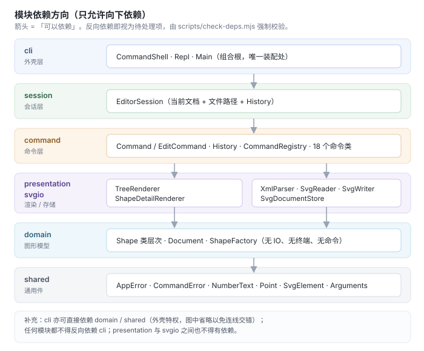
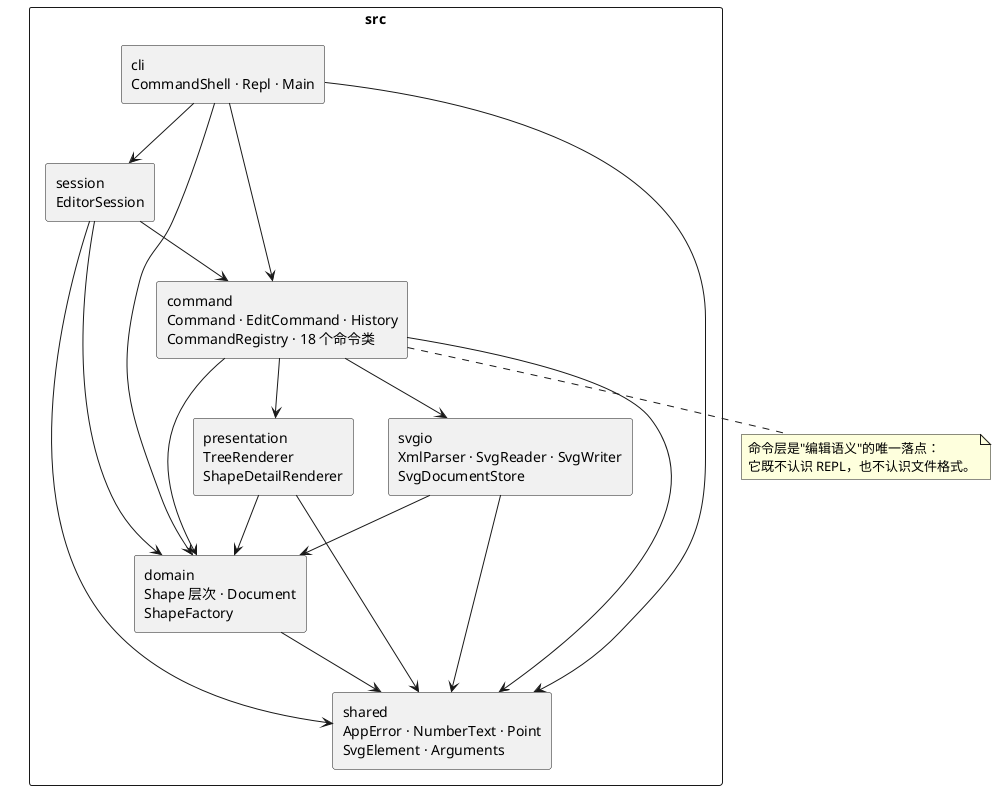
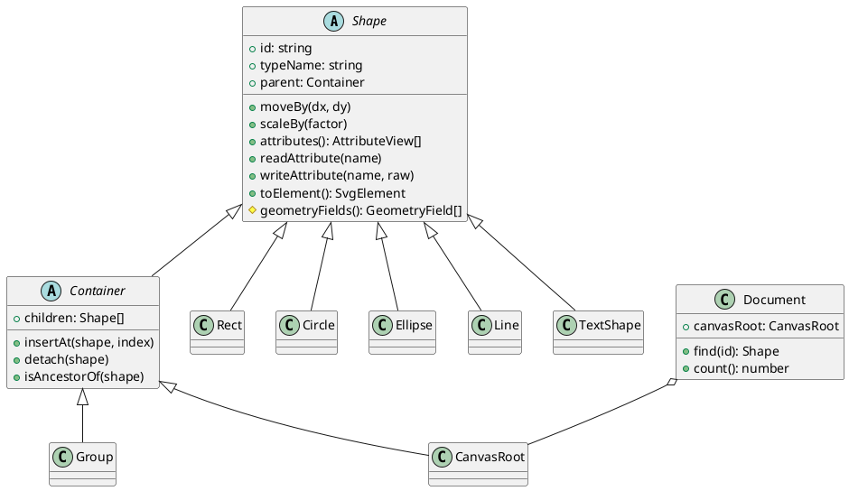

# Lab1 Phase 1 · SVG 编辑器（CLI）

TypeScript 实现的命令行 SVG 编辑器：以 `id` 寻址，命令式编辑，支持分组（Composite）、逐命令撤销重做，读写标准 SVG 文件。

- **仓库地址**：<https://github.com/wyh666check/wyh>
- **最终提交**：annotated tag `final`，指向 `main` 分支末端提交
- **作者**：王宇豪（2801762879@qq.com）

```bash
git clone https://github.com/wyh666check/wyh.git
cd wyh
git checkout final
npm install
```

```text
npm install
npm run cli                 # 交互式 REPL
node dist/src/cli/Main.js < examples/session.txt   # 脚本回放
npm run verify              # 架构校验 + 全部回归测试
```

---

# 一、架构方案

## 1.1 模块划分

七个模块，单向依赖，每个模块只回答一类问题。

| 模块 | 目录 | 职责 | 明确不做的事 |
|---|---|---|---|
| **shared** | `src/shared` | 与业务无关的通用件：错误类型（`AppError`/`CommandError`）、数字解析与显示（`NumberText`）、坐标值对象（`Point`）、SVG 元素描述（`SvgElement`）、参数视图（`Arguments`） | 不认识任何图形、命令、文件 |
| **domain** | `src/domain` | 图形模型：`Shape` 类层次、容器 `Container`/`Group`/`CanvasRoot`、聚合根 `Document`、图形工厂 `ShapeFactory` | 不读文件、不打印、不认识命令，**完全不知道"编辑器"存在** |
| **presentation** | `src/presentation` | 把 domain 对象渲染成文本：`TreeRenderer`（结构树）、`ShapeDetailRenderer`（属性明细） | 不改变状态，不认识命令 |
| **svgio** | `src/svgio` | SVG 文本 ↔ `Document`：`XmlParser`、`SvgReader`（含缺 id 补全）、`SvgWriter`、`SvgDocumentStore`（唯一接触 `fs` 的类） | 不认识命令、不决定编辑语义 |
| **command** | `src/command` | 命令模式全套：`Command`/`EditCommand` 骨架、18 个命令类、`History` 撤销栈、`CommandRegistry` 注册表、`ArgumentList`/`CommandTokenizer` 解析 | 不接触 stdout/stdin，不 `new` 具体前端 |
| **session** | `src/session` | 编辑会话：当前文档 + 文件路径 + 历史栈（`EditorSession`） | 不做渲染、不解析命令行 |
| **cli** | `src/cli` | 外壳：`Repl`（提示符与读写行）、`CommandShell`（切词 → 查表 → 执行）、`Main`（组合根，唯一装配处） | 不含业务判断 |

规模：63 个源文件 / 约 3500 行，每个文件一个类（或一个与被校验文件同名的接口/类型别名），由脚本强制。

**组件图（渲染版，`doc/architecture.svg`）**



PlantUML 源（可在任意 PlantUML 环境重新渲染）：



**图形模型内部**（Composite 的核心）：



## 1.2 设计模式的选择

### （1）Command —— 编辑操作的唯一形态（规范强制要求）

**问题**：19 条命令若各自散落在 REPL 的 `if/else` 里，"撤销"就只能靠全局快照或反向推断，且"解析"与"执行"混在一起，报错时机不可控。

**落地**：

- `Command`（抽象）→ `execute(target)`：一条命令就是一个对象。
- `EditCommand`（抽象，模板方法）→ 固定骨架
  `prepare()`（**只读**：校验 + 拍快照）→ `apply()`（变更 + 回显）→ 入栈。
  这条骨架把"命令失败不改变任何状态"从"记得先判断"变成了**结构上不可能违反**。
- `History` 只认识 `EditCommand.rollback()` / `replay()` 两个方法，撤销重做与具体命令解耦。
- 18 个具体命令类：`CreateShapeCommand`、`DeleteShapeCommand`、`MoveShapeCommand`、`ScaleShapeCommand`、`SetAttributeCommand`、`GroupShapesCommand`、`UngroupCommand`、`AddToCommand`、`ReorderCommand`（`front`/`back` 共用一套实现）、`InitCommand`、`ReadCommand`、`SaveCommand`、`CanvasCommand`、`TreeCommand`、`ShowCommand`、`HelpCommand`、`UndoCommand`、`RedoCommand`。

**"一条命令 = 一个 undo 单元"如何保证**：`group g1 b c` 是**一个**对象，其 `prepare` 里保存了每个成员的原父容器与原下标，`rollback` 一次性全部插回——不存在"撤销一半"的中间态。

### （2）Composite —— 容器与叶子统一操作

`Shape.moveBy/scaleBy/attributes/summary` 全部是抽象方法：`Container` 的实现是"递归到每个子孙"，叶子是"改自己的坐标"。

于是**命令层没有任何 `switch (tag)`**：`move node2 0 100` 与 `move c1 30 0` 走完全相同的代码路径，区别只在多态实现里：

```ts
// MoveShapeCommand.apply() —— 与操作的是 rect 还是 g 完全无关
shape.moveBy(this.dx, this.dy);
```

连"回显该说 `moved to (x,y)` 还是 `moved by (dx,dy)`"也由多态决定：`Shape.anchor()` 返回 `null` 表示容器没有唯一定位点。

### （3）Factory + Registry —— 唯一的"类型名 → 类"分派点

`ShapeFactory` 内是一张 `Map<string, ShapeTypeEntry>`（类型名 / `create` 语法 / 构造器）。规范允许的两处按名字分派之一落在这里，另一处是 `CommandRegistry`（命令名 → 实现）。两处都在类注释里标了 **待重构**：Phase 2 把它们换成运行时可插拔的 `ShapeProvider` / `CommandProvider`，调用方签名不变。

### （4）Memento —— 命令自己保存"还原所需的最小状态"

不保存整份文档，只保存命令真正动过的东西：

| 命令 | 快照内容 | 撤销方式 |
|---|---|---|
| `move` / `scale` | 无需快照 | 参数逆运算（`-dx,-dy` / `1/factor`） |
| `set` | 旧值原文（含"原本不存在"） | 旧值回写；原本不存在则 `clearAttribute` |
| `delete` | 原对象、原父容器、原下标 | 原对象插回原位 |
| `group` / `ungroup` / `addto` / `front` / `back` | 每个成员的原父容器与原下标 | 按**下标升序**插回，精确还原 z-order |

"旧值原文"这一条是有意的：`set a fill red` 撤销后必须回到"没有 fill"，而不是"fill 为空串"——两者在 SVG 里渲染结果不同。

### （5）Facade —— 三处收口

`EditorSession`（对命令层）、`SvgDocumentStore`（对磁盘与格式）、`CommandShell`（对文本输入）。三者都只暴露一两个方法，把易变细节关在内部。

### （6）Dependency Inversion —— `CommandTarget` 接口

命令需要"拿到当前文档、换掉当前文档、操作历史栈"，但**不需要认识 session 类**。`CommandTarget`（`src/command/CommandTarget.ts`）把这个需求声明成 6 个成员，`EditorSession` 实现它。收益：command 模块与 session 模块之间没有循环依赖，命令可以在测试里用 10 行假对象驱动。

## 1.3 依赖方向规则

**只允许向下依赖**（箭头 = 可以依赖，反向一律视为待处理项）：

```text
cli ──► session ──► command ──► presentation ──► domain ──► shared
                       └──────► svgio ─────────► domain ──► shared
cli ──────────────────────────────────────────► domain ──► shared
```

| 模块 | 允许依赖 | 理由 |
|---|---|---|
| `shared` | 无（仅 Node 内置） | 它是最底层，被所有人依赖；一旦它能反向依赖别人，依赖图立刻成环 |
| `domain` | `shared` | 图形模型必须能在**没有文件、没有终端**的环境里被构造与推理，这是可测试性的根 |
| `presentation` | `domain`, `shared` | 渲染是"读模型"，只能单向读取 |
| `svgio` | `domain`, `shared` | 序列化是"模型 → 文本"，方向固定 |
| `command` | `presentation`, `svgio`, `domain`, `shared` | 命令既要产出文本回显，也要触发 store 读写——它是**编排者**，允许使用下面两层 |
| `session` | `command`, `domain`, `shared` | 会话持有历史栈（`command`）与文档（`domain`） |
| `cli` | 全部 | 外壳可以认识一切；**任何模块都不许反向依赖 `cli`** |

两条额外约定：

1. `presentation` 与 `svgio` **互不依赖**（渲染不需要文件，序列化不需要文本排版）；
2. 只有 `cli/Main.ts` 可以 `new` 具体实现（组合根），其余模块一律通过构造参数接收依赖。

**为什么把 `presentation` 放在 `command` 下面而不是上面**：显示类命令（`tree`/`show`）的输出格式是**命令的返回值**，渲染器必须能被命令调用。把它放上层会造成 `command → cli` 的反向依赖。它只依赖 `domain`，因此"低层"这个位置是成立的。

**强制手段**：`npm run check:deps`（`scripts/check-deps.mjs`）扫描 `src/**/*.ts` 的每条相对 import，按上表判定；同时校验"文件名 = 声明的类/接口名"。违反即非零退出，`npm run verify` 会连带失败。**规则不靠人眼，靠 CI。**

## 1.4 变化点假设

按"最可能变 + 影响面最大"排序。每条写明**留了什么**或**为什么决定不留**。

### V1 · 新增图形类型（`box` 复合图形插件）—— 已留插槽

Phase 2 的 `box` 是"一个命令创建、内部 rect+text、整体又是容器"的复合图形。

已留：
- `ShapeFactory` 注册表 + `ShapeTypeEntry(name, syntax, builder)`：新增类型 = 注册一条表项，**命令层零改动**；
- `Container.allowsUngroup()`：普通 `g` 恒为 `true`，`box` 覆写为 `false` 即可产出规范要求的 `error: cannot ungroup composite shape: n1`；
- `Shape.toElement()` 自描述 + `summary()`/`attributes()` 多态：`g#n1 (box)` 这种类型标注与 `data-kind="box"` 标记由子类自己加；
- `create` 的 `in` 子句已支持"容器作为父"，`box` 天然可再嵌套。

**本阶段不做**：`SvgReader` 里"凭 `data-kind` 还原为 `box`、缺插件则降级为普通 `g`"的分支。理由：Phase 1 只有一种容器类型，此时写还原分支没有第二种类型可还原，是纯死代码。等到真有第二种类型时，改动点只在 `SvgReader.buildGroup()` 一处（已预留 `localTag` + 属性访问）。

### V2 · 寻址从 `id` 扩展到结构路径 / 选择器 —— 决定不留

技术上只需引入一个 `ShapeRef` 值对象，把 18 条命令的 `id: string` 换成解析后的引用。

不留的理由：规范把"以 id 定位"作为一次显式设计决策（SVG 的 `id` 是合法属性，`<use>`/CSS/fragment 导航都依赖它），且 CLI / agent / 鼠标三个通道都只需要回答"改哪个图形"。**引入路径寻址会同时带来解析、转义、失效检测三套新问题，而本阶段收益为 0。**

代价评估：真要做时改动是机械的（命令构造签名 + `Document.require`），不构成架构风险。→ 记为**主动接受的技术债**。

### V3 · 撤销策略从"逐命令逆运算"换成整份文档快照 —— 已留切换点

`History` 只依赖 `EditCommand.rollback()` / `replay()`。换成快照只需让命令在 `prepare` 阶段保存 `Document` 深拷贝，或在 `History` 里改存快照——**其它代码零改动**。

为什么现在不选快照：快照对"一条命令 = 一个 undo 单元"表达力弱（结构还原退化为整体替换），更重要的是拿不到规范 6 节要求的精确回显（`rect#box restored into g#markers` 需要知道原父容器是谁）。快照还要求图形可深拷贝（即需要 `clone()`），而当前设计靠"原对象插回原位"完全绕开了这个问题。

### V4 · 存储格式从 SVG 换成 JSON / 远端 —— 已留插槽

`SvgDocumentStore` 是唯一接触 `fs` 的类；`domain` 只产出 `SvgElement` 值对象，不知道 XML 长什么样。

换格式 = 新写一个 `XxxStore`（同样的 `read/write` 签名）+ 在 `Main` 换一行装配。**命令层与 domain 零改动**。

### V5 · 属性白名单扩张（`opacity` / `font-size` / `text-anchor` / `transform`）—— 部分留，部分明确不留

已留：`GeometryField` 是声明式的——新增几何属性只需在对应形状类里加一行 `new GeometryField(...)`，`set` 白名单、`show`、`tree`、序列化四处自动跟上。样式属性集中在 `Paint`，加一个字段 + 一个分支即可。

**明确不留**：`font-size` / `text-anchor` / `style` / 未知元素（如 `<path>`）目前在读入时被丢弃（`style` 静默、未知元素告警）。理由不是"懒得做"，而是它们会**扩散成语义决策**：一旦引入 `font-size`，就必须同时决定 `scale` 是否缩放字号（规范说 factor 乘到"全部几何属性"，字号算不算几何？）、`tree` 是否显示、`set` 是否允许、`box` 模板如何继承——这些决策在 Phase 1 没有需求驱动，凭猜测定下来反而会挡住 Phase 2 的正确设计。已在"已知限制"里如实登记。

### V6 · 交互通道从 stdin 扩展到 agent / 鼠标 —— 已留骨架，缺一项能力

`Command` 对象可被任何前端构造；命令不接触 stdout（只返回 `CommandResult.lines`）；`CommandShell` 与 `EditorSession` 无耦合。

**已知缺口**：鼠标拖拽会产生"每帧一条 `move`"，需要把连续命令合并成一个 undo 单元（`History.begin/commit` 或命令合并）。这是新需求，当前 `History` 只有"压栈即提交"一种语义。等真做鼠标时再加，而不是现在猜。

---

# 二、过程记录

以下是与 AI 智能体协作过程中，**发现偏差 → 确认依据 → 纠正**的关键回合。每条都能在代码或测试里找到对应痕迹。

### R1 · `#` 的上游歧义：注释还是颜色？

AI 最初按"行内 `#` 起注释"实现切词。回放规范 6 节 transcript 时，`create rect bg 0 0 800 600 #ffffff` 直接把颜色吃掉，`bg` 被建成黑色矩形。

确认：规范 2 节写的是"**`#` 开头**为注释"，而 6 节里 `#ffffff` 出现在参数位置。两者只能靠"整行首非空白字符为 `#`"兼容。

纠正：`CommandShell.isComment()` 只看行首，切词器完全不认识 `#`。补测试「注释行与空行不产生输出」，其中同时断言 `# 这是注释` 被跳过、`#ff0000` 被当成颜色。**这条约束是从 transcript 反推出来的，不是规范正文直接写的**——所以一定要有测试钉住。

### R2 · `tree` 对 `line` 的摘要多了一个 `stroke=`

AI 第一版让 `line` 的树摘要输出 `(280,130) -> (520,130) stroke=black`（理由是"内联关键属性"）。但规范 6.1 的 transcript 明确只显示坐标。

确认：`stroke` 是外观而非几何；`rect` 显示 `fill` 是因为规范 5.1 的样例这么写，`line` 的样例没有 `stroke`。按 transcript 裁决。

纠正：`Line.summary()` 只输出 `(x1,y1) -> (x2,y2)`，外观交给 `show`。

### R3 · 容器 `move` 的回显写成了 `(0,0)`

`MoveShapeCommand` 最初把"容器没有定位点"的分支实现成 `moved by (0,0)`——因为 `describe()` 里没有拿到位移量。手工冒烟时看到 `g#node2 moved by (0,0)`，而规范要求 `(0,100)`。

纠正：把 `dx/dy` 作为参数传进 `describe()`，撤销分支传 `-dx/-dy`。**这类错误不会被类型检查发现**（`0` 是合法的 `number`），只能靠"对着 transcript 逐字读输出"。这也是为什么把 transcript 做成断言。

### R4 · `group` 撤销必须按下标**升序**插回

AI 初稿用降序插回，理由是"从后往前插不会挤动前面的元素"。推演 `[a,b,c,d,e]` 中 group `a,c`（下标 0 和 2）后撤销的过程，得到反例：

```text
去 a,c 后剩余 [b,d,e]
降序：插 c@2  → [b,d,c,e]      ← c 落到了 d 后面
      插 a@0  → [a,b,d,c,e]    ← 与原始 [a,b,c,d,e] 不符
升序：插 a@0  → [a,b,d,e]
      插 c@2  → [a,b,c,d,e]    ✓
```

根因是 `insertAt` 会把下标 clamp 到 `[0, length]`：列表被抽空一部分后，**高位下标在缩短的列表里已经失去意义**，降序插回只能靠运气命中。升序则可以逐次验证——插入第 j 个成员时，列表正好是"剩余元素 + 前 j-1 个正确归位的成员"，此时原下标就是准确位置。

纠正：`revert()` 里先 `sort((l, r) => l.index - r.index)` 再逐个插回，并补测试「ungroup / addto / front / back 均可撤销，且还原原始位置」用 `[a,b,c]` 完整比对。

### R5 · 原计划保留 `<g transform>`，实测会双重位移

Phase 1 一开始打算把 `transform` 原样保留在容器上、序列化时写回。问题是：`move`/`scale` 对容器是**递归到子孙**的，如果容器自身还带一个 `translate`，视觉上就叠加了两次。

三个方案：① 保留 transform 且命令不再递归（与规范的"作用于容器时递归到每个子孙"冲突）；② 保留 transform 并拒绝在带 transform 的容器上执行几何命令（用户会撞墙）；③ 读入时把 transform **烘焙**进子孙坐标、内部只存绝对坐标。

选 ③。理由是它守住了两条更重要的不变量：`tree` 显示的一定是"画布上的真实坐标"，且 undo 完全不必处理矩阵。代价是非等比 `scale` 与 `rotate` 无法烘焙——这类文件会告警并忽略该 transform，而不是悄悄算错。

这条后来变成了架构层面的表述：**内部坐标一律绝对，容器不承担坐标系变换**（写在 `Container` 类注释里）。

### R6 · `save` 之后是"清空历史"还是"锁住历史"？

AI 初稿把 save 当成"文档边界"，直接清空撤销栈。规范 4.3 写的是"执行后 undo/redo **禁止**……直到下一次编辑命令重新解禁"——是"锁"，不是"清空"。

纠正：`History` 区分两个方法——`reset()`（`init`/`read` 换整份文档时用，旧命令引用的图形已不在树上，必须丢弃）与 `lock()`（`save`/`canvas` 改尺寸时用，只置位）。`push()` 无条件解禁。这个区分让"锁"和"丢"两种截然不同的语义没有混在一个方法里。

### R7 · 测试也会错：`ungroup` 用例的前提搞错了

写「错误文案对齐」用例时，AI 让 `start` 建在**根级**却断言 `group inner scene start` 报"容器不能收进自己的子孙"——实际它们是兄弟，命令合法。

确认：对照规范 4.2 的报错表，该错误的成立前提是"被选中的容器是另一个被选中图形的祖先"。是**测试的前提错了**，不是实现对错。

纠正：把 `start` 建进 `scene` 里（`... in scene`）。

顺带暴露了一个真正的设计问题：`ungroup` 顶层容器会被拒绝（规范 4.2 要求），所以"测试 ungroup 撤销"必须先把 `g1` 放进另一个容器。原用例直接 `group g1 b c` 建在根级，一执行就报 `cannot ungroup top-level container: g1`——测试红了，但实现是对的。**这时候要把规范原文当成裁决者，而不是把实现改成迎合测试。**

### R8 · 骨架先行，再逐层填肉

实际推进顺序（对应 git 提交历史）：

```text
chore    工程骨架（tsconfig / 目录 / .gitignore）
feat(domain)     Shape 层次 + Document + ShapeFactory
feat(svgio,presentation)  读写 + 渲染
feat(command,session,cli) 命令模式 + 历史 + REPL
test     回归测试 + 架构校验脚本
docs     本文档
```

先做 domain 有两个好处：`command` 层写的时候，所有"类型分派"问题已经在多态里解决了；`presentation` 先于 `command` 完成，`tree`/`show` 命令就只剩一行调用。

每完成一层都做一次全量 `tsc --noEmit`，避免错误跨层累积。

---

# 三、一致性自查

## 3.1 模块划分

对照 1.1 的方案检查实际目录：

| 方案中的模块 | 实际目录 | 是否一致 |
|---|---|---|
| shared | `src/shared`（6 个文件） | ✅ |
| domain | `src/domain`（15 个文件） | ✅ |
| presentation | `src/presentation`（2 个文件） | ✅ |
| svgio | `src/svgio`（7 个文件） | ✅ |
| command | `src/command`（29 个文件） | ✅ |
| session | `src/session`（1 个文件） | ✅ |
| cli | `src/cli`（3 个文件） | ✅ |

**偏差一处，已记入修订记录**：组合根原为 `src/cli/main.ts`（一个 `main()` 自由函数），改为 `src/cli/Main.ts`（`Main` 类 + `static run()`）。原因见修订记录 R-1。除此之外目录结构、模块职责与方案一致，没有"临时塞进去"的文件。

## 3.2 依赖方向

**自动校验**（`npm run check:deps`）：

```text
✓ 架构校验通过：63 个源文件，模块依赖方向与命名约定均符合方案。
```

**抽样人工核对**（每层各取一处，确认与 1.3 的表一致）：

| 抽样文件 | import | 是否符合规则 |
|---|---|---|
| `domain/Document.ts` | `CanvasRoot`、`CommandError`、`NumberText`、`SvgElement` | ✅ 只依赖 `domain` 内部 + `shared` |
| `svgio/SvgDocumentStore.ts` | `node:fs`、`CommandError`、`Document`、`SvgReadResult`… | ✅ `svgio → domain, shared`，未反向依赖 `command` |
| `command/MoveShapeCommand.ts` | `CommandResult`、`Document`、`EditCommand`、`NumberText`、`Point`、`Shape` | ✅ `command → domain, shared`，未引用 session/cli |
| `session/EditorSession.ts` | `CommandTarget`、`History`、`Document`、`CommandError` | ✅ `session → command, domain, shared` |
| `cli/CommandShell.ts` | `CommandRegistry`、`CommandTarget`、`CommandTokenizer` | ✅ `cli → 全部`（外壳特权） |

**结论：方案里的规则没有被违反。** 唯一需要说明的是 `command → presentation` 这条边：它意味着"命令可以调用渲染器"，与常规的"UI 在最上层"直觉相反。理由已在 1.3 写清（显示类命令的输出格式是命令的返回值），并且 `presentation` 只依赖 `domain`，不会造成环。

**反向抽查**（确认没人偷偷依赖 cli）：`check-deps.mjs` 的 `ALLOWED` 表中，只有 `cli` 能依赖 `cli` 之外的任何模块，其它模块的允许列表里都不含 `cli`，脚本通过即证明无反向依赖。

---

# 四、质量保证手段

## 4.1 自动化：`npm run verify`

```text
check:deps  →  架构与命名校验（63 个文件）
test        →  21 条 node:test 用例，全部通过
```

四条独立的质量线：

| 手段 | 位置 | 拦的是什么 |
|---|---|---|
| **transcript 逐条对齐** | `test/Transcript.test.ts` | 输出文案与规范 6 节/6.1 节不一致（含 `tree` 的缩进与列对齐、`show` 的分行） |
| **错误文案逐条对齐** | `test/CommandErrors.test.ts` | 规范 4.2 表格共 11 行，其中 10 行被断言（唯一未覆盖的是 `cannot ungroup composite shape`，Phase 1 没有该类型） |
| **round-trip 字节一致** | `test/SvgRoundTrip.test.ts` | 序列化不稳定（属性顺序/浮点格式/转义）导致 git diff 噪音或读回失真 |
| **撤销语义** | `test/UndoRedo.test.ts` | 一条命令拆成多个 undo 单元、顺序还原错误、redo 栈未清空、io 后未锁定 |

## 4.2 关键不变量（用测试钉住，不靠自觉）

1. **命令失败不改变任何状态**：`test/CommandErrors.test.ts` 里对 9 条错误命令连续执行后，断言 `tree` 输出与执行前**逐字节相同**。
2. **`tree` 是唯一的"事实来源"**：所有结构类断言都走 `tree`，而不是去摸内部对象——这让测试与 UI 的认知保持一致。
3. **保存的文件能被自己读回**：`save → read → tree 相同 → 再 save 字节相同`，一条链路覆盖 writer 与 reader 两侧。

## 4.3 手工冒烟

```bash
node dist/src/cli/Main.js < examples/session.txt   # 脚本回放（含注释，验证 # 规则）
```

生成的 `examples/flowchart.svg`、`demo.svg` 直接拖进浏览器渲染，肉眼核对坐标与层级——**序列化正确不等于画出来对**，这一步是补自动化测试的盲区。

## 4.4 一致性检查机制

- 分层规则与命名规则由 `check-deps.mjs` 强制（违反即构建失败），因此"架构漂移"会在提交前暴露，而不是等评审。
- `help` 文本从 `CommandRegistry` 生成，不存在"文档说支持、实际没实现"的漂移。
- 所有错误文案集中产生于 `CommandError`，由 `CommandShell` 统一加 `error: ` 前缀，不存在某条命令忘了加前缀的情况。

## 4.5 已知限制（如实登记）

| 限制 | 影响 | 状态 |
|---|---|---|
| `font-size` / `text-anchor` / `style` / `class` 等属性读入时丢弃 | 外部 SVG 的文字字号与对齐会回落到浏览器默认 | 设计取舍，见 V5 |
| 未知元素（`<path>`/`<polygon>` 等）读入时跳过并告警 | 图形丢失（有告警，不静默） | Phase 2 可扩类型 |
| 非等比 `scale`、`rotate`/`matrix` 变换不烘焙 | 该 `<g>` 上的 transform 被忽略并告警 | 见 R5 |
| `id` 查找是深度优先遍历（O(n)），无索引 | 万级图形时会变慢 | 文档量级（数百）下无影响 |
| `tree` 列宽按整棵树最长 `type#id` 计算 | 深层子树可能比规范样例多几个空格 | 规范未规定列宽，保证每列对齐即可 |

## 4.6 修订记录

| 编号 | 修订内容 | 原因 | 影响面 |
|---|---|---|---|
| R-1 | 组合根 `cli/main.ts`（自由函数）→ `cli/Main.ts`（`Main` 类） | 满足"一类一文件、文件名 = 类名"，并让 `check-deps.mjs` 的命名校验无例外 | 仅入口文件与 `package.json` 的 `main`/`cli` 脚本 |
| R-2 | `Line.summary()` 去掉 `stroke=` | 对齐规范 6.1 transcript | 显示层 |
| R-3 | `group` 撤销改为按下标升序插回 | 降序插回依赖 `insertAt` 的下标 clamp，正确性不可归纳 | `GroupShapesCommand.revert` |
| R-4 | `<g transform>` 从"原样保留"改为"读入时烘焙" | 避免与递归 `move`/`scale` 叠加造成双重位移 | `SvgReader`，并确立"内部绝对坐标"不变量 |
| R-5 | `History` 拆分 `reset()` 与 `lock()` | 规范 4.3 的语义是"锁"而非"清空" | `History`、`EditorSession` |
| R-6 | `#` 注释规则收紧为"整行首非空白" | 与颜色值 `#ffffff` 兼容 | `CommandShell`、`CommandTokenizer` |
